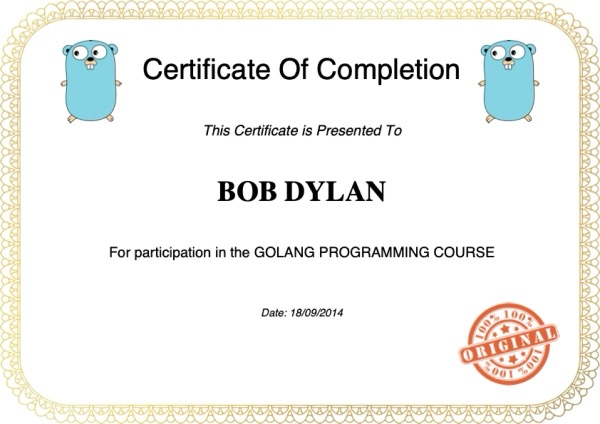
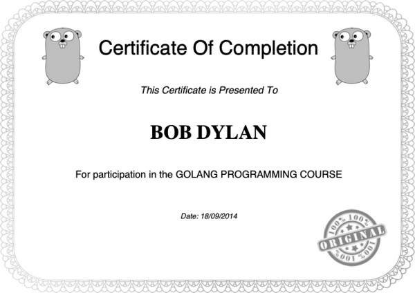

# go-imgproc

A concurrent image processor written in Go. It finds every `.jpg` in a folder (including subfolders), applies a **grayscale** or **blur** filter to each one, and writes the results to an output folder. It also times the run. The images are processed in parallel, and you can choose between two Go concurrency patterns to compare them: a **`sync.WaitGroup`** with one goroutine per image, or a **worker pool built on channels**.

| Original | `-filter grayscale` | `-filter blur` |
| :------: | :-----------------: | :------------: |
|  |  |  |

## Origin

I wrote this while following the Udemy course **[Le langage Go : formation complète](https://www.udemy.com/course/le-langage-go-formation-complete/learn/)**, a French-language course on Go. This project is the course's fifth exercise (`05-imgproc`) and is part of my Go learning. It focuses on **goroutines, channels and `sync.WaitGroup`**.

## Features

- Walks the source folder and its subfolders and collects every `*.jpg` file.
- Two filters, built on [disintegration/imaging](https://github.com/disintegration/imaging):
  - `grayscale`: converts the image to grayscale.
  - `blur`: applies a Gaussian blur (sigma `3.5`).
- Two concurrency strategies:
  - `waitgrp`: starts **one goroutine per image** and waits for all of them with a `sync.WaitGroup`.
  - `channel`: starts a **fixed pool of N workers** that take jobs from a channel.
- Saves the results as JPEG at quality 90 and prints how long processing took.

## Getting started

### Requirements

- Go 1.21+ (tested with Go 1.26)

### Build

```bash
git clone git@github.com:tonystrawberry/go-imgproc.git
cd go-imgproc
go build -o imgproc .
```

### Usage

```bash
# The output directory must already exist
mkdir -p out

# Grayscale, one goroutine per image (defaults)
./imgproc -src ./photos -dst ./out

# Blur, with a pool of 8 workers fed through channels
./imgproc -src ./photos -dst ./out -filter blur -task channel -poolsize 8
```

| Flag        | Default     | Description                                          |
| ----------- | ----------- | ---------------------------------------------------- |
| `-src`      | none        | Input directory, searched including subfolders       |
| `-dst`      | none        | Output directory (**must already exist**)            |
| `-filter`   | `grayscale` | `grayscale` or `blur`                                |
| `-task`     | `waitgrp`   | `waitgrp` or `channel`                               |
| `-poolsize` | `4`         | Number of workers (only used with `-task channel`)   |

Example output:

```
Generating file list...
Processed [2/6] photos/img2.jpg => out/img2.jpg
Processed [5/6] photos/img5.jpg => out/img5.jpg
...
Done processing files!
Image processing took 65.03ms
```

The `[i/n]` numbers come out of order because the goroutines finish in whatever order they happen to run. That's concurrency at work.

## Project structure

```
.
├── main.go            # CLI: flags, pick a Filter and a Tasker, time Process()
├── filter/
│   └── filter.go      # Filter interface + Grayscale and Blur implementations
├── task/
│   ├── task.go        # Tasker interface, shared dirCtx, recursive file listing
│   ├── waitgrp.go     # WaitGrpTask: one goroutine per file + sync.WaitGroup
│   └── chan.go        # ChanTask: worker pool fed by a jobs channel
└── docs/              # Preview images used in this README
```

## How it works

The program is built around **two small interfaces**, and `main.go` combines one of each:

```go
type Filter interface {           // what to do to one image
    Process(srcPath, dstPath string) error
}

type Tasker interface {           // how to schedule the work
    Process() error
}
```

The filters don't need to know about concurrency, and the concurrency strategies don't need to know which filter they are running. Any `Filter` works with any `Tasker`.

### `filter/filter.go`: the image filters

Each filter does the same three steps:

1. Opens the source image with `imaging.Open`.
2. Transforms it with `imaging.Grayscale(src)` or `imaging.Blur(src, 3.5)`.
3. Creates the destination file and encodes the result with `jpeg.Encode` at quality 90.

### `task/task.go`: shared pieces

- `dirCtx` holds `SrcDir`, `DstDir` and the list of files. It is **embedded** in both task types, which is how Go reuses fields through composition rather than inheritance.
- `buildFileList` uses `filepath.Walk` to go through the source folder and its subfolders and keep the paths ending in `.jpg`.

### `task/waitgrp.go`: one goroutine per image

```
for each file:  wg.Add(1); go applyFilter(...)   // calls wg.Done() when finished
wg.Wait()                                        // block until the counter is 0
```

This is the simplest approach and gives as much parallelism as possible. The catch is that 10,000 images start 10,000 goroutines at once, all opening files and holding decoded images in memory at the same time.

### `task/chan.go`: a worker pool using channels

```
jobs    := make(chan jobReq, n)   // buffered queue of work
results := make(chan string, n)   // buffered queue of finished paths

start PoolSize workers:   for j := range jobs { filter.Process(...); results <- j.dst }
send every job to jobs, then close(jobs)  // closing ends each worker's range loop
read n values from results                // this is how the program waits for completion
```

This is the classic Go **worker pool**. The number of images processed at once is capped at `-poolsize`, which keeps memory and CPU use under control. The channel directions in the `worker` signature (`<-chan` for receive-only, `chan<-` for send-only) let the compiler check that workers only read jobs and only write results.

### Comparing the two

Run the same folder with `-task waitgrp` and with `-task channel -poolsize N` for different N, and compare the printed times. Image processing mostly uses the CPU, so a pool about the size of your CPU core count (`runtime.NumCPU()`) usually performs as well as the one-goroutine-per-image approach while using far less memory.

### Go concepts covered

- Goroutines and the `go` keyword
- `sync.WaitGroup` (`Add` / `Done` / `Wait`)
- Buffered channels, `close`, `range` over a channel, and send-only / receive-only channel types
- The worker-pool pattern
- Interfaces (`Filter`, `Tasker`) and struct embedding (`dirCtx`)
- Constructor functions that return an interface (`NewWaitGrpTask`, `NewChanTask`)
- Walking folders with `filepath.Walk`
- Timing code with `time.Now()` / `time.Since()`
- Image decoding and encoding with `image/jpeg` and a third-party library

## Known limitations

This is learning code, so it has a few rough edges:

- **Errors from `Filter.Process` are ignored.** If `-dst` doesn't exist, every file is reported as "Processed" but nothing is written. Create the output folder first.
- A `-src` folder that doesn't exist causes a nil-pointer panic in `buildFileList`, because the error passed to the `filepath.Walk` callback is never checked.
- An unknown `-filter` or `-task` value leaves the interface nil, which also causes a panic.
- Only lowercase `.jpg` files are found. `.jpeg`, `.JPG` and `.png` are skipped.
- Output files are written flat into `-dst`, so two images with the same name in different subfolders overwrite each other.
- In `waitgrp.go`, `wg.Done()` isn't deferred, so a panic inside a filter would leave `Wait()` blocked forever.
- The original course code had no `go.mod`, since it was written for GOPATH. One was added (module `training.go/imgproc`) so it builds with current Go toolchains.

## Credits

- Course: [Le langage Go : formation complète](https://www.udemy.com/course/le-langage-go-formation-complete/learn/) on Udemy
- Image library: [disintegration/imaging](https://github.com/disintegration/imaging)
- The preview images are a certificate generated by my [go-gencert](https://github.com/tonystrawberry/go-gencert) project. The Go gopher in it was designed by [Renée French](https://reneefrench.blogspot.com/) and is licensed under CC BY 4.0.
